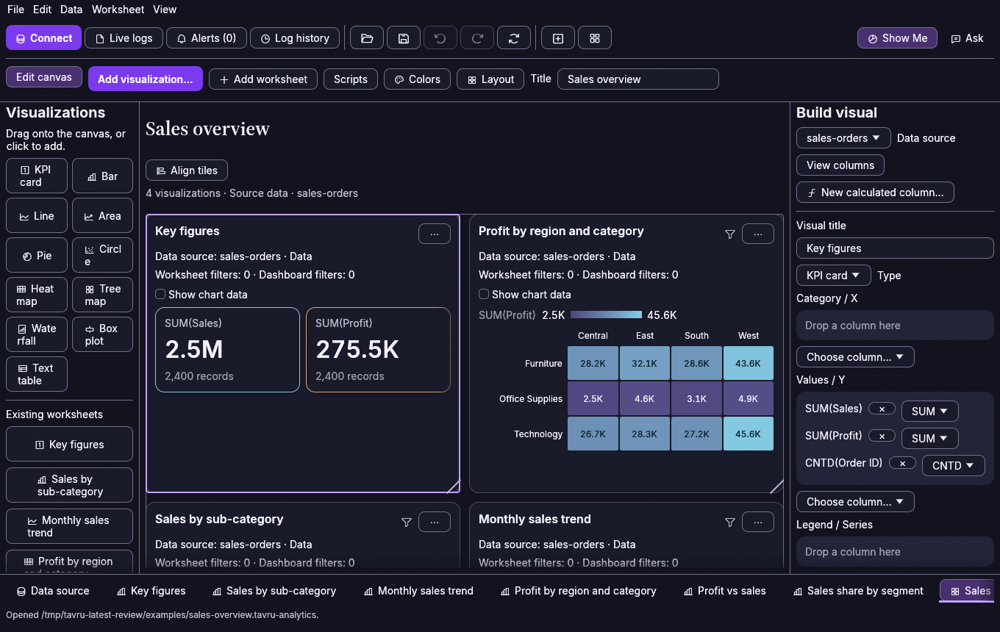

# Tavru Analytics advanced dashboard guide

[All guides](README.md) · [Build your first sales dashboard](analytics.md)

Open the dashboard you built from [sample-sales.csv](samples/sample-sales.csv).
The examples below use the same six rows. Exact controls depend on your installed Analytics build.

## Add controls and link charts

1. Add two worksheets to the dashboard, one for revenue by region and one for revenue by product. Use **Add worksheet** to reuse a saved sheet, or **Add visualization…** to choose a source, measure, aggregation, grouping field, and chart type. Review the preview, then choose **Add to dashboard**.
2. Open the region tile’s options and choose **Use as filter**. Select the **East** mark. The other tile should now show East’s revenue by product: Notebook 1,200 and Planner 1,600.
3. Clear the selection to see all regions again. Choose **Stop using as filter** on the region tile to turn off the link.
4. To keep a filter on one worksheet, place a field on its **Filters** shelf and choose the values or range it should include. Use the field menu or drag the field from the Data pane. A worksheet filter stays with that worksheet. A dashboard filter tile lets the person viewing the dashboard change the selection.

## Build and arrange the layout

- Choose **Layout → Overview** to preview compact metric cards above a chart grid. Apply the preview to use it. Add a KPI using **Sum of Revenue** and verify it shows **8,400** before filtering.
- Turn on **Edit canvas** for manual placement. Drag a tile’s header to move it or the bottom-right corner to resize it. Use numeric position and size controls for exact placement. The guides help snap neighboring edges or centers together. Hold **Alt** while dragging to position freely. Unlock a tile before moving it.
- Use **Align tiles** to align selected unlocked tiles without changing their sizes. Use **Ctrl+Z** to undo an applied layout or a completed move.
- Select a tile to open **Build visual**. Choose the source and chart type. Assign category labels to **Category/X**, a numeric measure to **Values/Y**, and an optional grouping field to **Legend/Series**. Drag fields or use the dropdowns. Use **View columns** if you need to check the data types.
- Use **Colors** for the dashboard palette. A tile can override it. Keep labels or legends visible so readers can distinguish series without relying on color.

## Have Analytics infer a starting point

### Recommend charts from a dataset

Open **Worksheet → Recommend visuals…** after connecting data. Analytics uses table and field names, field roles, and counts to recommend chart bindings. With a configured Oqelith runtime, it can use on-device assistance without sending row values to it for this feature. Otherwise, it can suggest charts from the data’s shape.

Preview each chart. Check the measure, aggregation, grouping and axis labels against your question. Choose **Add as sheet** for one chart or **Add all to a new dashboard** to use the recommendations together. For the sample CSV, check that a suggested revenue chart uses **Sum**, since a row count would answer a different question.

### Infer how two tables relate

1. Connect [sample-regions.csv](samples/sample-regions.csv) as a second source. It has one row per region and adds a territory label.
2. Open **Data source → Relationships**. Choose **Auto-draw with Oqelith**. Analytics measures candidate keys from the connected tables and can ask Oqelith to review the candidates. Review the dashed proposals and their evidence. If no proposal appears, use **Add a relationship** and select the columns manually.
3. Look for sales `Region` → lookup `Region`. It should be many-to-one from sales to lookup, with six matching sales rows and zero unmatched. Review cardinality and coverage before choosing **Accept** or **Discard**. A strong match rate alone cannot tell you whether a join makes business sense.
4. Select the accepted relationship. Check the keys and join type, then choose **Create joined table** when you want to use fields from both sources in a chart. Verify the joined table still has six sales rows and a revenue total of 8,400. Use a left join if you need to keep sales rows even when a lookup entry is missing.

### Draft a visual from a plain-language request

On a worksheet, open **Ask** and try “Show total revenue by region as a bar chart.” If Oqelith is configured, choose **Generate with Oqelith**. If it is unavailable, try **Preview local draft**. Check the preview against the expected totals before choosing **Apply**. Choose **Discard** to keep the current worksheet.
