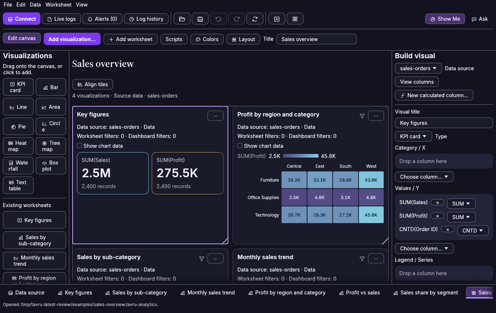

# Build a sales dashboard in Tavru Analytics

[All guides](README.md) · [Advanced controls, layout, and inference](analytics-advanced.md)

Practice with [sample-sales.csv](samples/sample-sales.csv). Save a local copy and keep it alongside your workbook. The sample is fictional and needs no database connection.

1. Open **Tavru Analytics**. Choose **Connect** and select the CSV. On **Data source**, confirm that `Region` and `Product` are categories and `Revenue` is numeric.
2. Open a worksheet. Place **Region** on **Columns** and **Revenue** on **Rows**. Select **Sum** on the Revenue pill and use **Show Me** to choose a bar chart. Tab to the field and use its menu if you prefer keyboard placement.
3. Add a second worksheet. Place **Product** on **Columns** and **Revenue** on **Rows**. Choose the sum again. Use **Show Me** to choose a bar chart or text table.
4. Choose **New dashboard**. Add the two worksheets as tiles. If your build has **Edit canvas**, turn it on to arrange and resize the tiles. Select a region tile as a filter if you want its selection to filter the product view.
5. Verify the first worksheet shows East at 2,800, North at 2,600, and West at 3,000. Save the workbook. Copy both it and the CSV when sharing, or choose **Save packaged copy with data** after checking which records will be embedded.

The screenshot shows a larger sample dashboard to illustrate how tiles can be arranged. Your two-chart exercise uses the smaller CSV linked above.

## Start with Tavru Sheets or share the result

Enter your data in Tavru Sheets with one header row and one record per row. Save an XLSX file, connect it in Analytics, and choose the worksheet with your data. After editing the spreadsheet, save it and press **F5** in Analytics to refresh.

Use the workbook's export commands to export a PDF for review in Tavru PDF or a PowerPoint deck for editing in Tavru Presenter. Review the exported page or slide before sharing.
