# App quickstarts

[All guides](README.md) · [Analytics](analytics.md) · [Code and Containers](code-and-containers.md)

## Everyday apps

### Tavru Files

Open your Pictures or Documents folder. Use the search box for filenames. For a broader search, enable indexing for folders you choose and let it finish. With visual search set up, try “photos of cats.” For receipts, include the month, year, or a location that appears in the indexed text. Open candidates to confirm the match. Indexed search runs on the device.

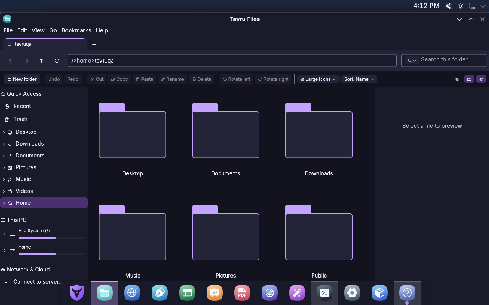

[Find receipts and photos](files-advanced.md).

### Tavru Browser

Open a new tab with **Ctrl+T**. Type a site address or search terms in the address bar. Use the bookmark control to save a page. If a trusted page breaks after the ad-blocking extension installs, open its controls and check its settings for that site.

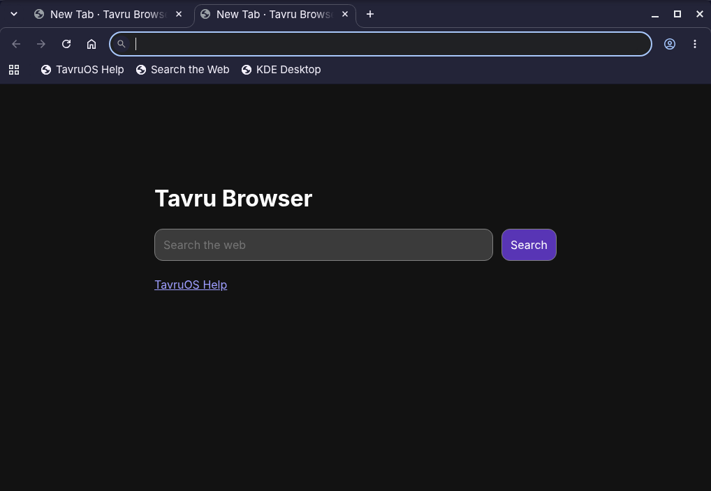

### Tavru Mail

Open the account setup screen, choose your provider or enter its mail settings, and finish the sign-in required by the provider. Wait for the inbox to sync. Compose a short message to yourself to check sending and receiving. If sync fails, check the provider's account and authentication requirements.

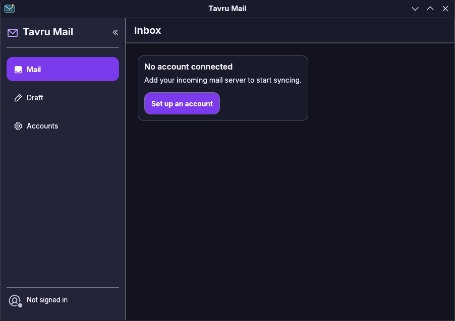

## Documents and presentations

### Tavru Docs

Choose a blank document or template. Enter a title and a few paragraphs, format the title as a heading, and save a working copy. Export a PDF and open it in Tavru PDF to check the page layout.

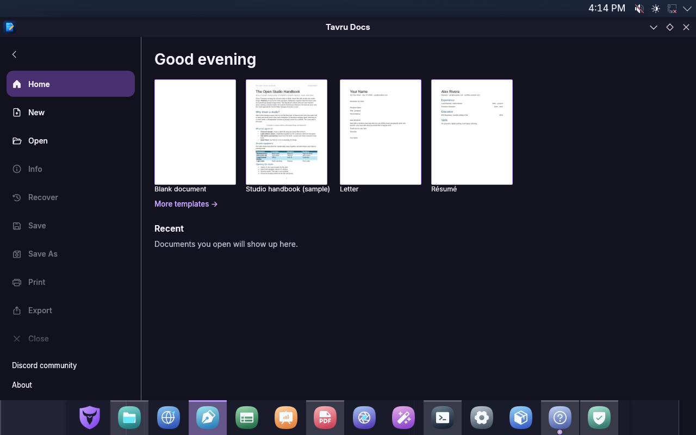

[Review tracked changes and publish a PDF](document-review.md).

### Tavru Sheets

Start a workbook. Put column names in the first row and records below. Enter numbers in a column and use a SUM formula to verify the total. Save as XLSX, then follow [the Analytics guide](analytics.md#start-with-tavru-sheets-or-share-the-result) to make charts.

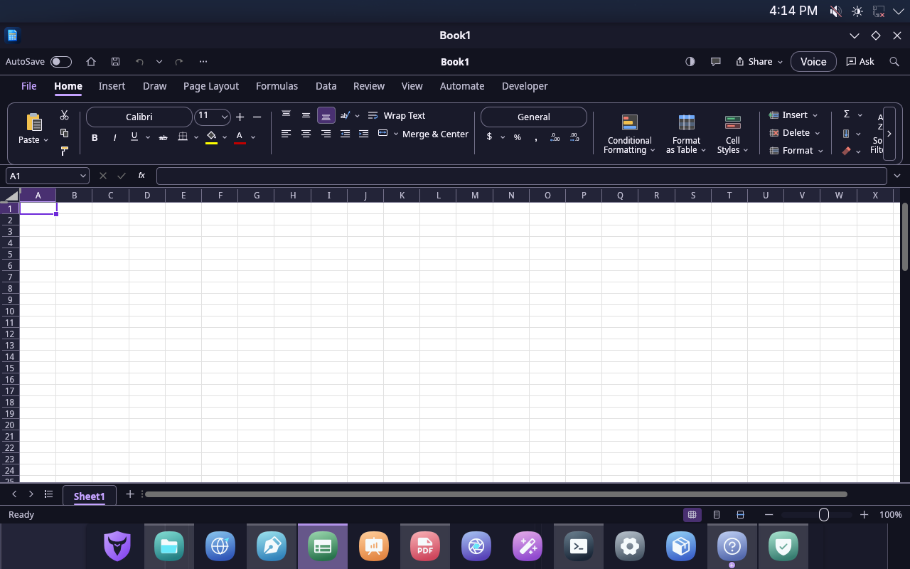

[Clean a workbook with Python and chart it in Analytics](sheets-advanced.md).

### Tavru Presenter

Choose a theme or open a slide deck. Add a slide, enter a heading, and add your speaking notes. Run the slideshow to check layout and readability, then save. To continue an Analytics report as slides, open its exported PowerPoint deck here.

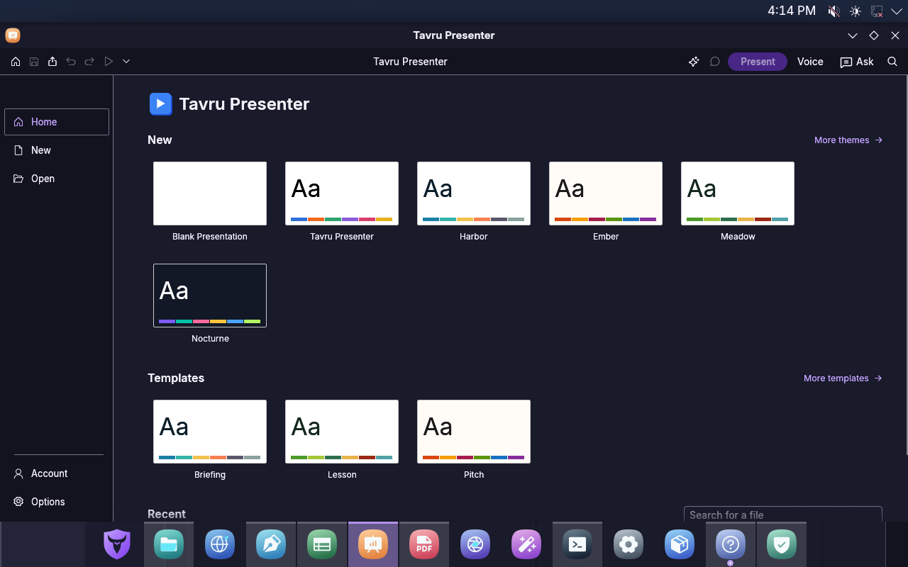

[Turn an Analytics dashboard into a briefing](presenter-briefing.md).

### Tavru PDF

Open a copy of a PDF. Use **Organize pages** to inspect page thumbnails or **Add comments** to mark a passage. Save a review copy and reopen it to confirm the pages and comments are present.

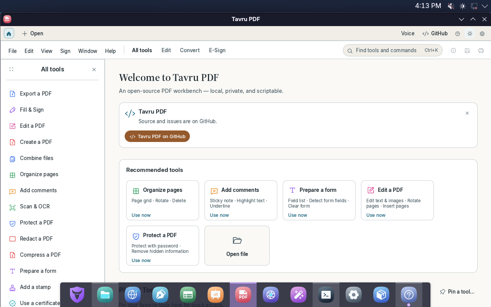

## Images and media

### Tavru Photo

Open a photo, duplicate its layer if you want to keep an untouched version, and crop or adjust the image. Save the layered project for later editing. Export a PNG or JPEG for use in Docs or Presenter.

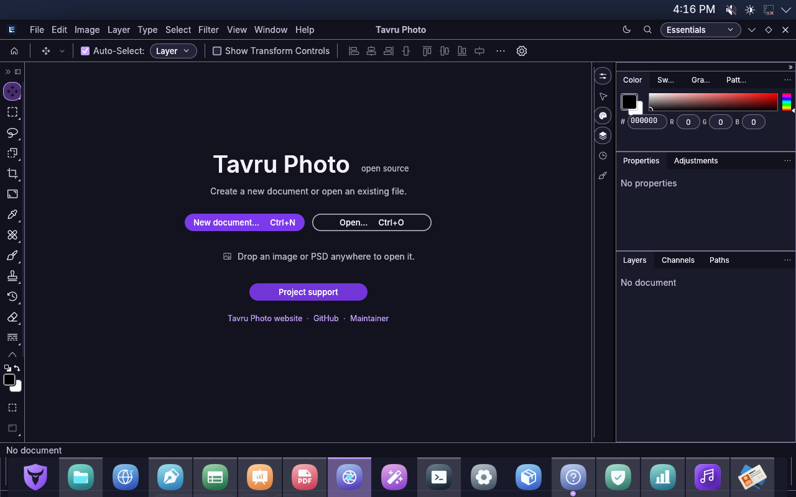

[Advanced workflow: expand a photo with generated content](photo-advanced.md).

### Tavru Imagine

Check that the on-device image runtime is available. Choose **Generate**, enter a simple description, and generate a draft. Open the result from **Gallery** and export it for use in Photo or Presenter. Generation depends on having a compatible model installed.

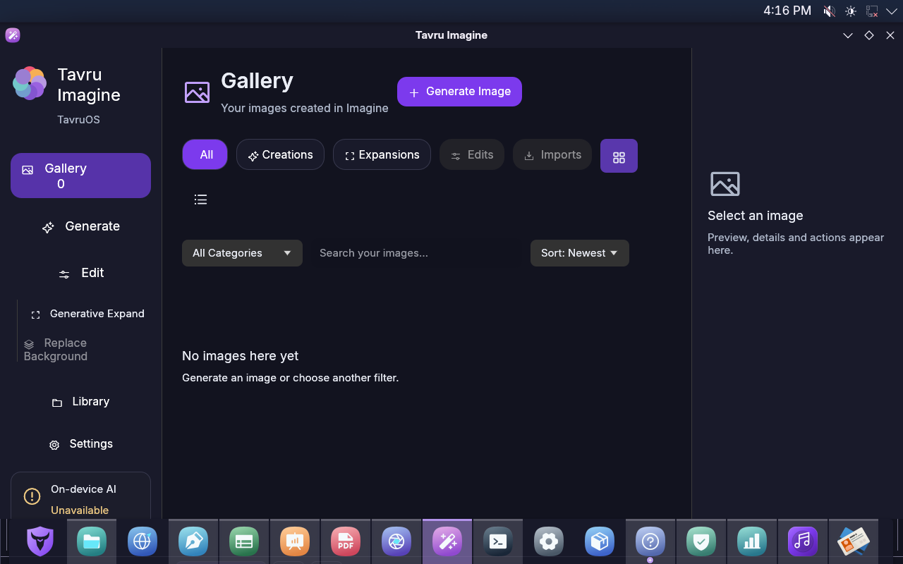

### Tavru Media

Open a local music or video file. Add several tracks to the queue, start playback, and reorder the upcoming tracks. For online channels or streaming services, choose the service and follow its connectivity or account requirements.

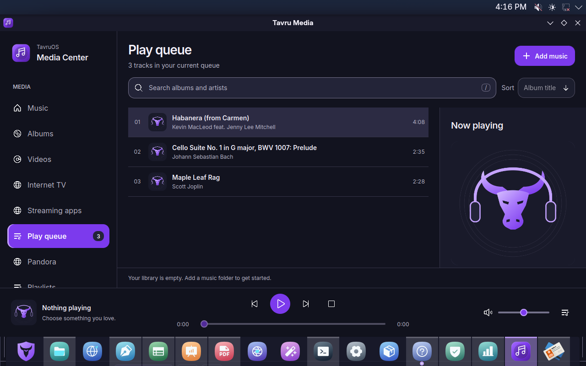

## System and desktop

### Tavru Security

Open the overview to check updates, software, and firewall status. Verify the app is connected to its native helper before relying on live status. When reviewing a firewall change, read the preview before applying. Confirm a working change when prompted, or let the timed rollback restore the previous rules. Use local assistance, if configured, to understand a proposed change before approving it.

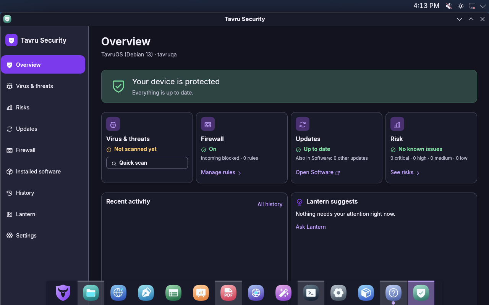

[Practice firewall preview and rollback](security-advanced.md).

### TavruOS desktop

Open the application menu and search for an app by name. Launch it and use the taskbar to switch between windows. Open System Settings for display, input, and accessibility options. For boot and installation steps, use the [TavruOS installer guide](https://tavruos.com/#install).

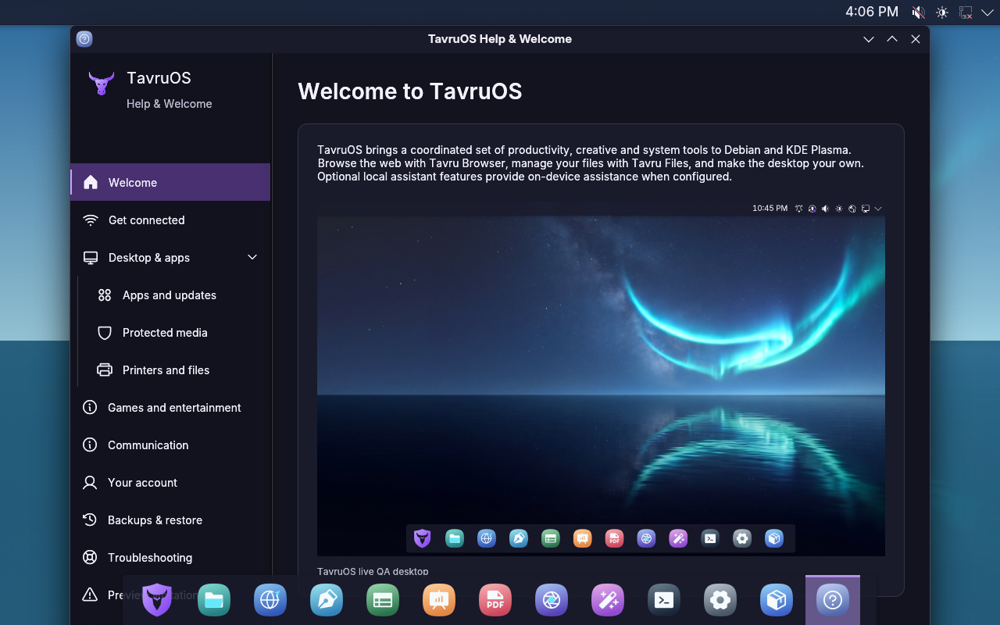

### Communication, entertainment, and games

Use **Communication** to find Discord, Slack, Zoom, and the Teams web shortcut. To play local media, open Tavru Media or VLC. Streaming entries open their respective services. For games, choose a launcher such as Steam Installer, Lutris, or Bottles and complete its setup before installing a supported game.

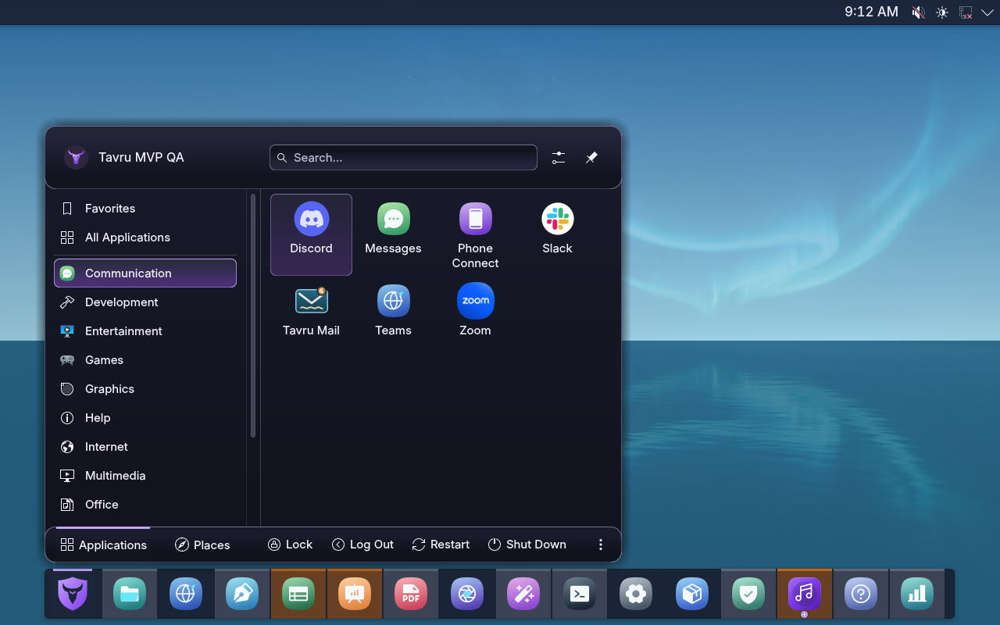
