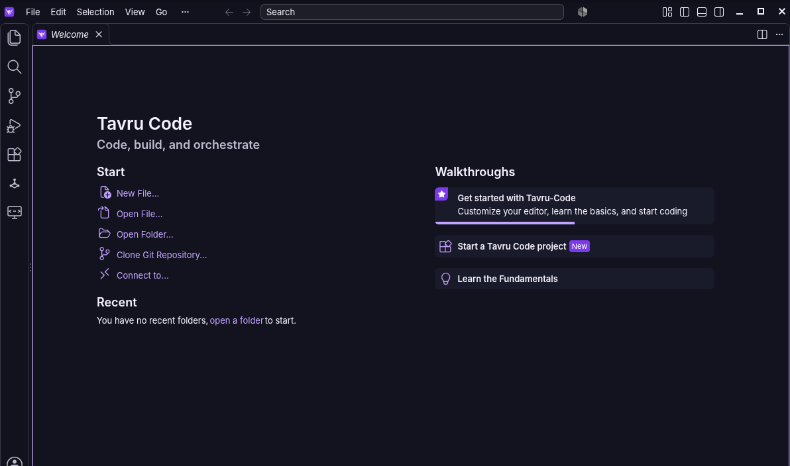
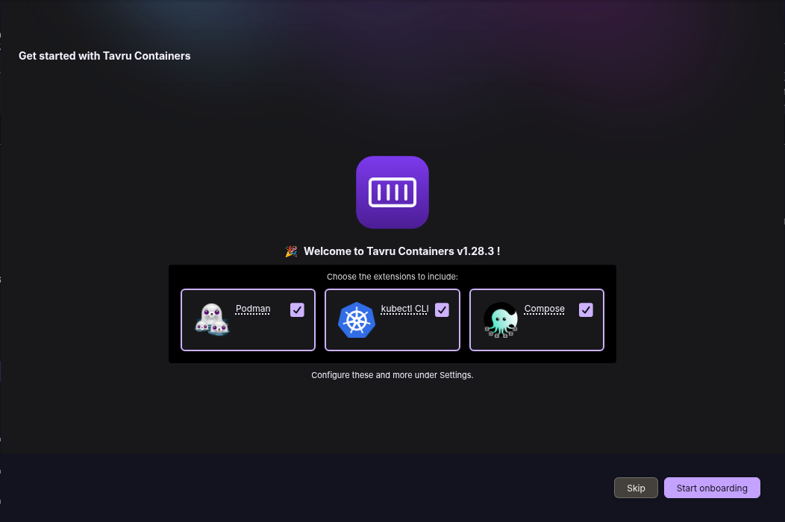

# Preview a local web project in Tavru Code and Tavru Containers

[All guides](README.md) · [Project templates and reusable snippets](code-templates.md)

Use a Tavru Code build with the Tavru Containers extension and an existing, working local backend. Choose rootless Podman or Docker with the Compose plugin. In the app, the selected backend and CLI context must point to the same engine. Run both apps as an ordinary user.

1. Open the Command Palette in Tavru Code and choose **Tavru Containers: Create Container Project**. If the command is missing, check the installed Code build and its extensions. The command requires Workspace Trust for the project.
2. Choose a parent directory, a new name such as `hello-tavru`, and a free port such as `8080`. Accept the local tagged image suggestion. Open the new folder and read its generated README, Containerfile, and manifest.
3. Edit `index.html` so you recognize the page. Open **Tasks: Run Task** in the Command Palette and choose one route below.
4. Open [http://127.0.0.1:8080](http://127.0.0.1:8080) in Tavru Browser, substituting your port. Verify that the page shows your edit.
5. Switch to Tavru Containers, select the backend you used, and refresh the inventory. Inspect the running container or pod and its image. A loopback port is local to the engine, so use a local engine for this exercise.

| Backend | Build and run | Stop when done |
|---|---|---|
| Podman | Run **Podman: Build Image**, then **Podman: Deploy Pod**. | Run **Podman: Remove Pod** for this sample. |
| Docker | Run **Docker: Deploy Stack** to build and start from Compose. | Run **Docker: Stop Stack**. |

To deploy from the dashboard after a build, open **Orchestration**, enter the absolute path to `pod.yaml` for Podman or `compose.yaml` for Docker, and review the action before confirming. Use one deployment path at a time.

If the port is busy, stop the sample from another backend or regenerate the project with an unused port. If the image build fails, check the task output for engine access and base-image availability.

## Use the local coding assistant

When Oqelith is ready, open **Ask** in Tavru Code and ask what serves `index.html` or which port is published. Review any proposed edits before applying them. Rebuild the sample after changing its files.
