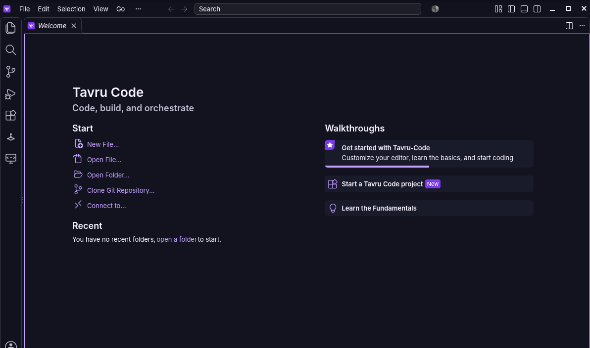

# Use project templates and snippets in Tavru Code

[All guides](README.md) · [Run a local project with Tavru Containers](code-and-containers.md)

Use a project template when you need a folder of coordinated files. Use a snippet when you want to insert a reusable block into a file you’re editing.



## Start with a container project template

1. Open the Command Palette and choose **Tavru Containers: Create Container Project**. This command requires the Tavru Containers extension and a trusted workspace. Choose a local parent folder and an unused name such as `team-preview`. The generator creates a new folder and refuses to overwrite an existing project.
2. Pick a free local port, such as **8080**, and accept the suggested local image tag for the exercise. Open the generated folder and read its README. Creating the files does not start a workload or contact a cluster.
3. Edit `index.html` to personalize the sample. Review the generated files before running anything:

   | File | What to check |
   |---|---|
   | `Containerfile` | Base image, files copied into the image, and the command that starts the sample server. |
   | `compose.yaml` | Docker service, build context, and local port mapping. |
   | `pod.yaml` | Podman image and local port mapping. |
   | `kubernetes.yaml` | Deployment and Service definitions for a configured cluster. |
   | `.vscode/tasks.json` | Commands Code will run when you select a build, deploy, or cleanup task. |

4. For Docker, run **Tasks: Run Task → Docker: Validate Compose**, then **Docker: Deploy Stack**. For rootless Podman, run **Podman: Build Image**, then **Podman: Deploy Pod**. Choose one backend for the sample.
5. Open `http://127.0.0.1:8080` in Tavru Browser, using the port you picked. Check your edit, then follow the [Code and Containers workflow](code-and-containers.md) to inspect and stop the workload. Rebuild the image after changing files that are copied into it.

The scaffold includes Kubernetes tasks and Terraform files for separate workflows. Cluster deployments need a deliberate context and namespace choice and an image the cluster can pull. The local exercise uses the loopback address on your engine host and does not require a cluster or Terraform.

## Share a reusable snippet with your team

1. In the Command Palette, choose **Configure Snippets**, then choose the option to create a snippets file for this workspace. Alternatively, create `.vscode/team.code-snippets` in the project.
2. Paste this example. It offers an HTML status section with an editable heading:

   ```json
   {
     "Status section": {
       "scope": "html",
       "prefix": "status-section",
       "body": [
         "<section aria-label=\"${1:Status}\">",
         "  <h2>${1:Status}</h2>",
         "  <p>${2:All systems operational}</p>",
         "</section>",
         "$0"
       ],
       "description": "Insert a labeled status section"
     }
   }
   ```

3. Open an HTML file and choose **Insert Snippet → Status section**. Edit the highlighted heading, press **Tab** to go to the paragraph, and press **Tab** again to finish. The section label follows the heading because both use placeholder 1.
4. Commit the snippet file if your team should share it. Keep machine-specific paths and credentials out of templates and snippets. For a personal snippet, choose a user snippet file instead of a workspace file.
