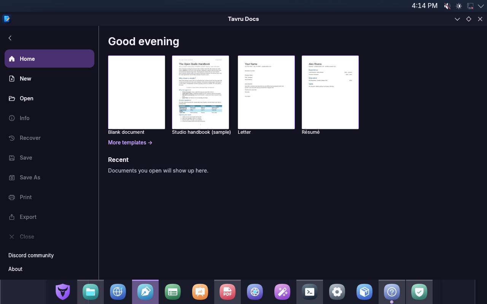
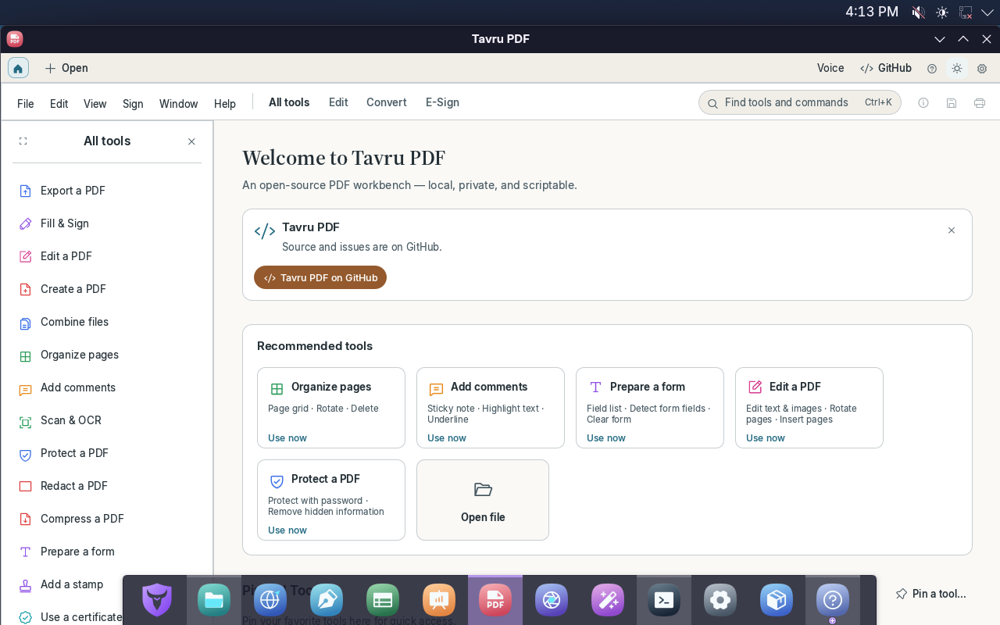

# Review a document in Tavru Docs and publish a PDF

[All guides](README.md) · [Document app quickstarts](apps.md#documents-and-presentations)

1. Create a short document in **Tavru Docs** and save a working DOCX copy. Try the sentence “The workshop starts at 10 a.m. Bring your laptop.”
2. On the **Review** tab, turn on **Track Changes**. Replace `10 a.m.` with `11 a.m.`, then add the sentence “Lunch is provided.” Save a review copy with markup visible.
3. Move through revisions with **Next**. Accept the time change and reject the lunch sentence. Use **Accept and Move to Next** when you want to continue through several edits. Review both the deletion of the old time and the insertion of the new one if they appear separately.
4. Confirm that the final text says “The workshop starts at 11 a.m. Bring your laptop.” Save the final DOCX. Use the export control to make a PDF.
5. Open the PDF in **Tavru PDF**. Check the text, page breaks, and links. If you find a content error, correct the DOCX and export again. Share the PDF once it looks right, and keep the reviewed DOCX if you need an editable record.

For collaborative review, exchange the DOCX while changes are still being discussed. Export the PDF after resolving revisions and comments, then verify the actual exported file.
