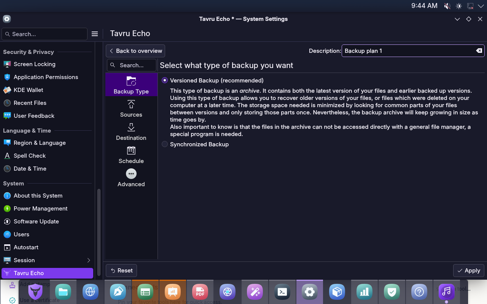
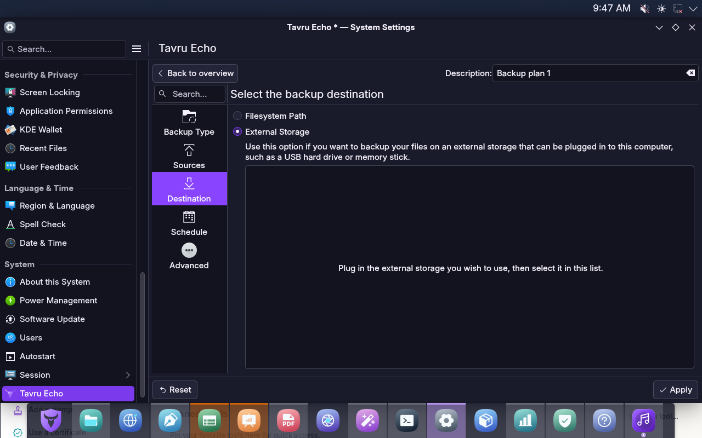
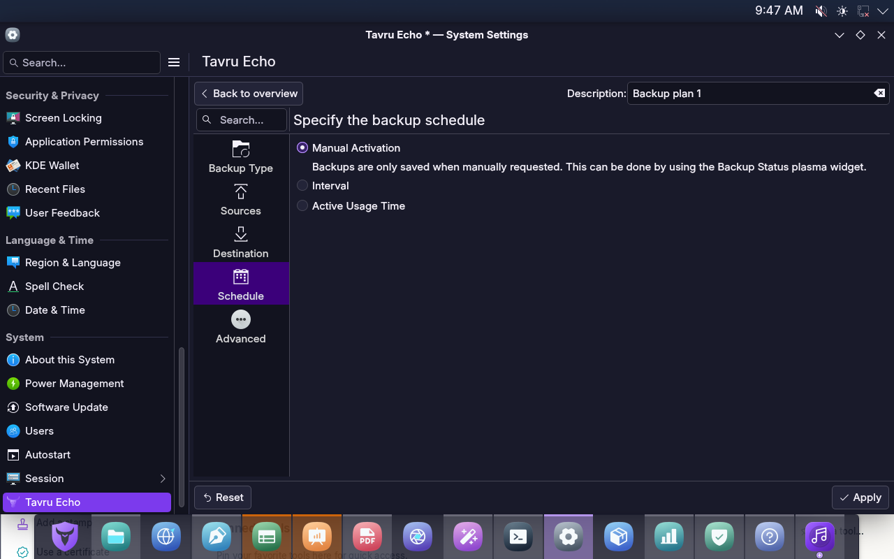
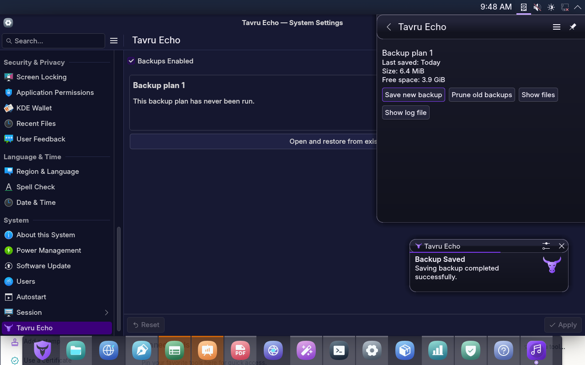
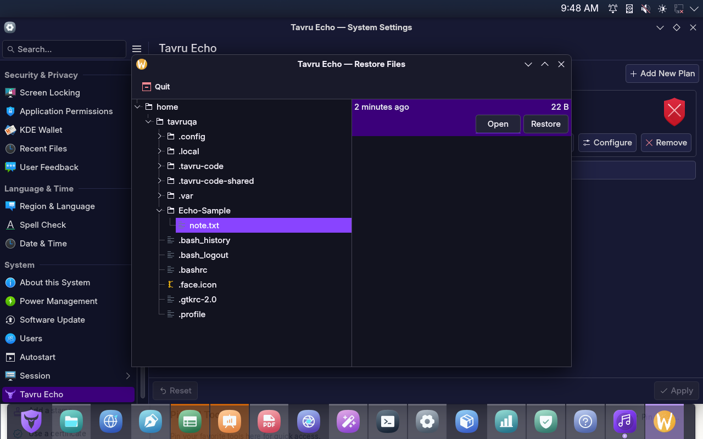
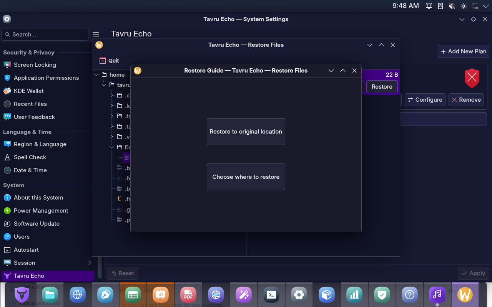
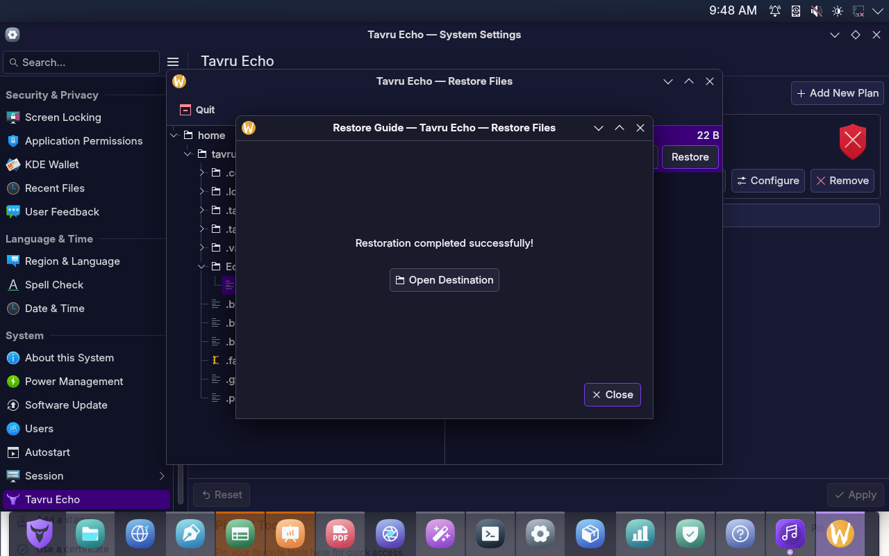

# Back up and recover files with Tavru Echo

Tavru Echo uses KDE’s Kup backup engine. A backup plan chooses the folders to protect, where to save their backups, and when Echo should run. Use it for personal files such as documents and photos. Keep your TavruOS installer separately so you can reinstall the system and then recover your files if the system drive fails.

## Create a plan

1. Search the application menu for **Tavru Echo** or open **System Settings → Tavru Echo**.
2. Select **Backups Enabled**, then **Add New Plan**.
3. Under **Backup Type**, choose **Versioned Backup** to recover earlier versions and deleted files from backups you still retain. Choose **Synchronized Backup** if you want a directly browsable copy that updates to match the selected folders, including deletions.
4. Under **Sources**, expand your home folder and review every checked entry. For a practice run, create a folder with a test document, clear the default selections, and select the test folder.

## Choose a destination and schedule

1. In **Destination**, choose **External Storage**, connect a USB drive, and select it. Use **Filesystem Path** for an existing folder on a separately mounted drive or network share. Keep that mount at the same path so Echo can detect when it is available.
2. In **Schedule**, choose **Manual Activation** for a practice run. **Interval** follows elapsed time and **Active Usage Time** follows accumulated computer use. Connect or mount the destination so the plan can run.
3. Select **Apply**.

## Save the first backup

Open **Tavru Echo** in the system tray and select **Save new backup**. Leave the destination connected until Echo reports **Backup Saved**. Check **Last saved** in the tray to see how recent your backup is.

## Restore a file

1. Connect the backup destination. For a versioned backup, open Echo in the tray and select **Show files**. You can also use **Open and restore from existing backups** in Echo settings to open an existing backup.
2. In **Restore Files**, navigate to the file and select the version you want from the list on the right. Select **Restore**.
3. Select **Choose where to restore** and save to a separate test folder. After Echo reports success, open the restored file and check its contents before replacing any working copy.
4. For a synchronized backup, browse the destination in your file manager and copy the file back from there.

The screenshots use a disposable TavruOS VM and a sample text file. The restored copy matched the original byte for byte.
