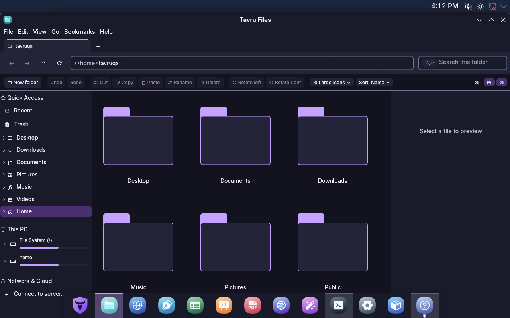

# Find receipts and photos with Tavru Files

[All guides](README.md) · [Tavru Files quickstart](apps.md#tavru-files)

Practice with a [fictional receipt image](samples/sample-01.png) and a cat photo from your own library. Put copies in a new folder such as `Documents/Search practice`. The sample receipt has a neutral filename so you can tell when search is using its contents.

1. In Tavru Files, open **Edit → Search Indexing…**. Enable indexing and add your practice folder. Review the folder list and remove any suggested folders you don’t want indexed.
2. Use **Full text** or **Smart**. Enable **Read text in photos (OCR)** and follow the prompt to install the optional local model. Wait for indexing to finish. In the search menu, choose **This folder and subfolders** with your practice folder open.
3. Search for `Phoenix`. Open the match and check that it says “Juniper Stationery” and shows a total of **$20.00**. The sample image’s filename contains neither the city nor the store.
4. Try `receipts from Phoenix in March 2025` with receipts dated in that period. The month and year narrow indexed file or photo dates. OCR lets the city match text printed in the image. A newly downloaded practice image may have today’s file date, so use `Phoenix` alone for that copy. For a text-based PDF, full-text search can read the text directly when its PDF text extraction tool is available.
5. Switch to **Smart** and enable **Search what’s in photos and videos**. After the optional visual model is installed and your cat photo is indexed, try `photos of cats`. Use a photo with a neutral filename to see how a match based on image content differs from a filename match.

If the result is missing, confirm the file is in an indexed folder, check which search scope you selected, and wait for the optional OCR or visual pass to finish. Search runs on the device. The app stores its index per user and encrypts it. Remove the practice folder from indexing when you’re finished.
