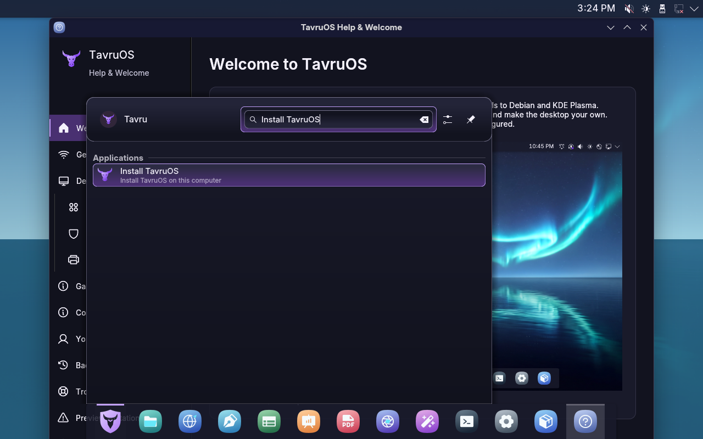
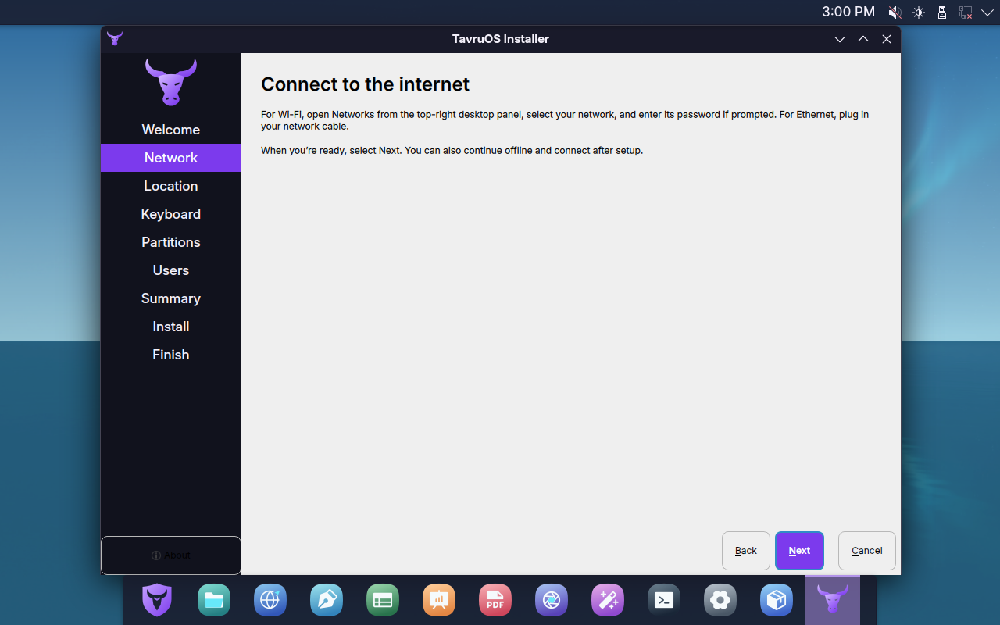
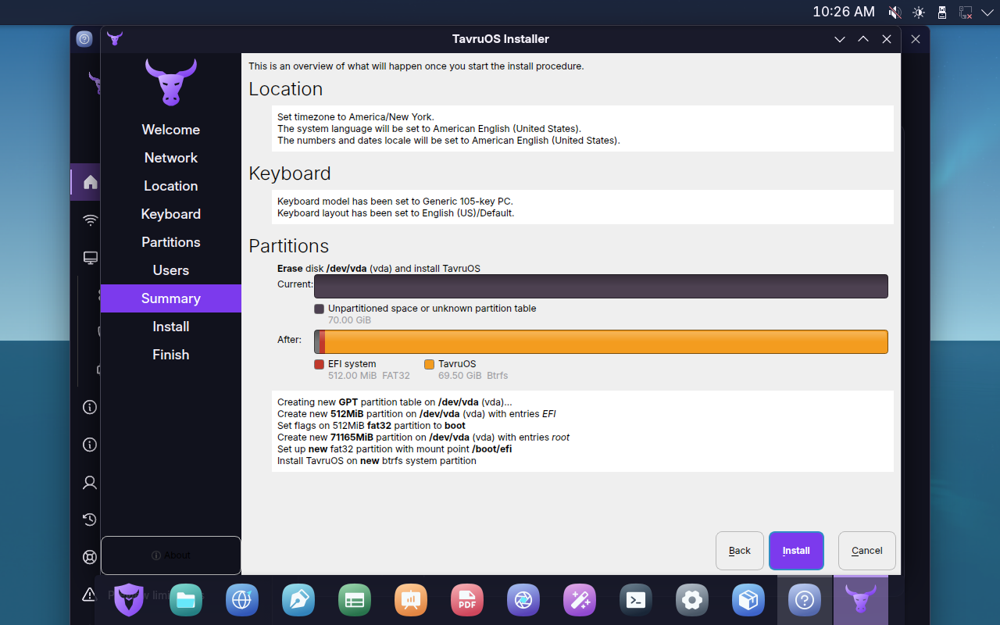
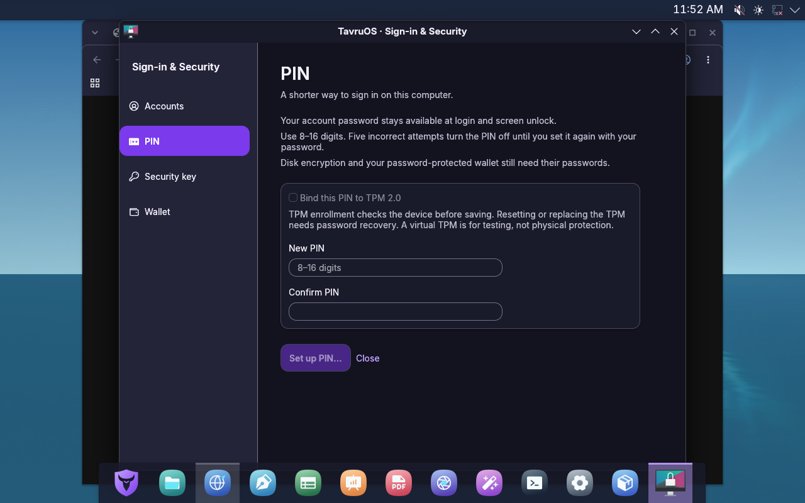
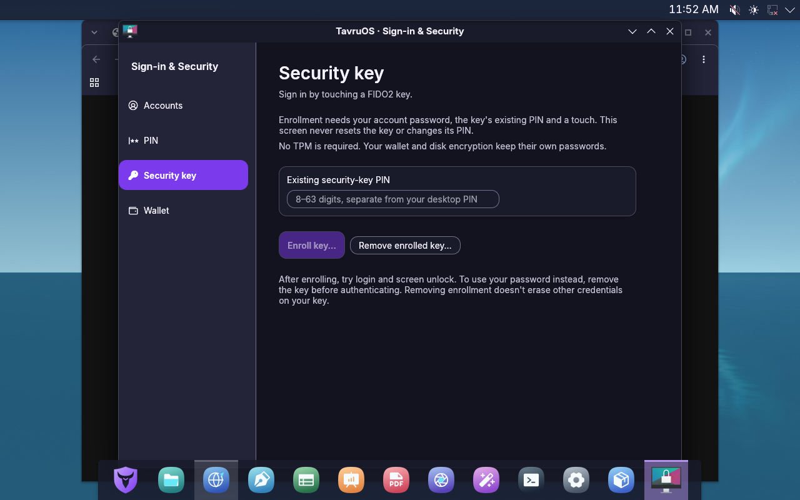
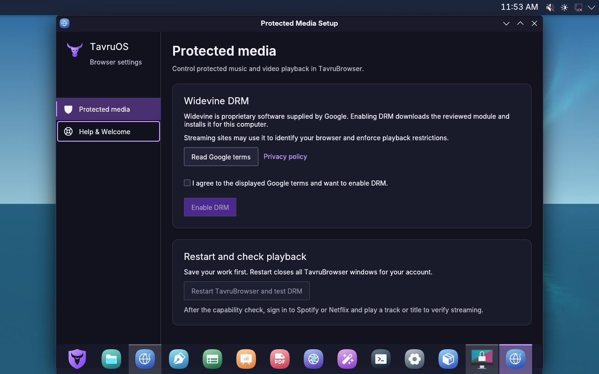
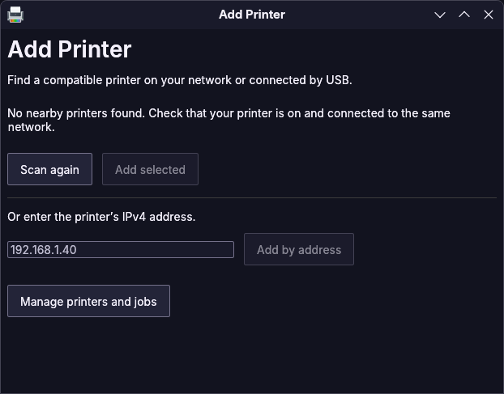

# Install TavruOS and set up your desktop

## 1. Boot from USB

1. Get the x86-64 ISO and SHA-256 checksum from [TavruOS](https://tavruos.com/#install). Follow the site's instructions to verify the download and write it to a USB drive of at least 32 GB. Back up the USB drive first because writing the ISO erases it.
2. Restart the computer, open its UEFI boot menu, and select the USB drive. Choose **Live system (amd64)** at the TavruOS boot menu.
3. In the live desktop's application menu, search for and open **Install TavruOS**.

## 2. Connect to Wi-Fi

At the installer's **Network** step, open **Networks** in the top-right panel. Select your Wi-Fi network, choose **Connect** if prompted, and enter the network password. When the panel shows a connection, return to the installer and select **Next**. You can also use Ethernet.

For an offline install, select **Next** and open **Connect to Wi-Fi** from the application menu after your first sign-in. If your network does not appear, check that Wi-Fi is enabled and airplane mode is off, then look again or use Ethernet.

## 3. Install and sign in

1. Choose your location and keyboard layout. At **Partitions**, check the drive name and capacity. Back up any files you want to keep before using **Erase disk**, which wipes the selected drive.
2. Under **Users**, create your local account and set a password. Keep it available for account recovery and system authorization.
3. On **Summary**, review the disk and partition changes. Select **Install**, then **Install Now** when you are ready.
4. When **Sign-in & Security** opens, you can set up the sign-in methods below or select **Continue installation** and configure them later.
5. When the installer reports **All done**, shut down, remove the USB or detach the ISO, then boot from the installed drive. Sign in with the account you created.

## 4. Set a desktop PIN

1. Open **Sign-in & Security → PIN**. Enter the same 8–16 digit PIN in **New PIN** and **Confirm PIN**.
2. If your computer supports it, you can select **Bind this PIN to TPM 2.0**. Keep your account password available for recovery if the TPM is reset or replaced.
3. Select **Set up PIN…** and enter your account password when prompted. Lock the screen and test your PIN with your password available. Five incorrect PIN attempts turn off PIN sign-in until you set it up again. Disk encryption and your password-protected wallet keep their own passwords.

## 5. Enroll a YubiKey

1. Plug in a FIDO2-capable YubiKey that already has a FIDO2 PIN. Open **Sign-in & Security → Security key**.
2. Enter the key's existing PIN in **Existing security-key PIN** and select **Enroll key…**. Authenticate with your TavruOS account password and touch the key when prompted. The key PIN and desktop PIN are separate.
3. Test screen unlock and sign-in. To use your account password, unplug the YubiKey before authenticating. **Remove enrolled key…** removes the TavruOS enrollment and preserves other credentials on the key.

## 6. Enable protected media

1. With the installed desktop online, open **Protected Media Setup**. Select **Read Google terms**. If you choose to accept them, check the box in the dialog and select **Agree and continue**.
2. Select **Enable DRM** and authenticate when prompted. TavruOS downloads and installs Google's proprietary Widevine module and records consent for the authenticated local account.
3. Save work in open browser tabs, then select **Restart TavruBrowser and test DRM**. Check the capability page first, then test a title you can access with your own streaming account. A successful module install alone does not verify playback.

## 7. Add a printer

1. Turn on the printer. Connect a network printer to the same local network as TavruOS, or plug in a compatible driverless IPP-over-USB printer.
2. Open **Printers**. In **Add Printer**, select the printer and choose **Add selected**. If it doesn't appear, choose **Scan again**. For a driverless network printer you can also enter its local IPv4 address and select **Add by address**.
3. Open **Manage printers and jobs** to check the queue. Print a test page or one-page document and verify it comes out of the expected printer.

The release's fresh install, offline path, and first password sign-in were verified in a disposable UEFI VM. The remaining screenshots show the setup controls. This walkthrough does not verify physical Wi-Fi association, printer output, PIN or YubiKey sign-in, or DRM playback.
