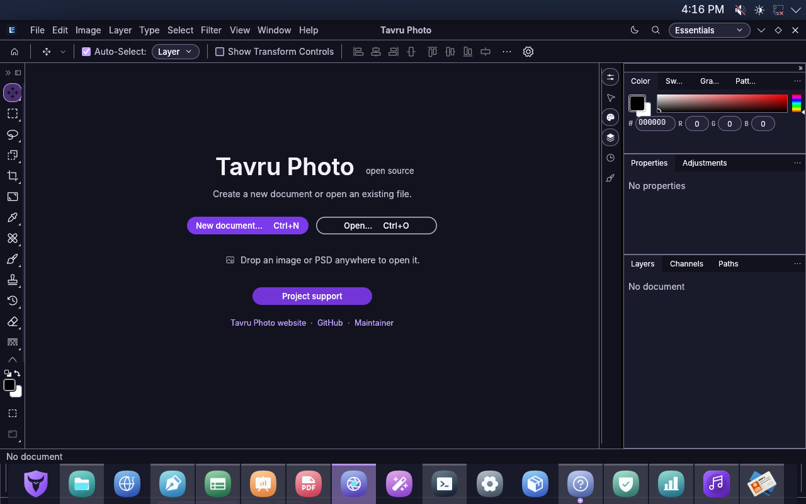

# Expand a photo with Tavru Photo

[All guides](README.md) · [Tavru Photo quickstart](apps.md#tavru-photo)

Use **Image → Expand Canvas** to add space around a photo and generate content in that new area. For example, extend a landscape to the right to leave room for a title. Tavru Photo keeps the original image area intact and places generated content on an editable layer.

The screenshot shows the editor workspace. **Expand Canvas** requires a Tavru Photo build that includes the feature, a running Oqelith runtime with masked image editing support, and a compatible local editing model. The preview ISO may have an earlier build.

## Extend a landscape to the right

1. Open a copy of a landscape photo and save a working project. For a first exercise, start with a 768 × 512 pixel copy on an ordinary pixel layer. Keep the full-resolution original separately. Expansion currently supports static pixel layers and groups without layer effects, artboards, or dissolve blending.
2. Choose **Image → Expand Canvas**. Set **Right** to **128** and **Left**, **Top**, and **Bottom** to **0**. The resulting canvas should be **896 × 512**. Each margin can be **0–512 px**. Both final dimensions must be **64–1,024 px** and multiples of **8**.
3. In **Prompt**, try “Continue the grassy hillside and pale sky to the right, matching the existing horizon and soft afternoon light.” In **Avoid**, optionally enter “text, buildings, extra people.” Keep the prompt focused on the new area.
4. Leave **Match generated edge colors** enabled for the first attempt. Start with the default **Edit strength** and sampling settings. Start the job and wait for it to finish. You can cancel while it runs.
5. Check the boundary at 100% zoom. Look for a shifted horizon, repeated details, or a visible color seam. Toggle the generated layer to see what was added. If you prefer another result, undo the expansion, adjust the prompt or margins, and run it again.
6. Save the layered project for further edits, then export a separate PNG or JPEG. Verify the exported dimensions before sharing.

## Choose the right tool

Use **Expand Canvas** when the image needs more space beyond its current edges. Use **Fill Selection** to change a selected area inside the existing canvas, or **Remove Object** to fill the area occupied by a distraction. For a crop that extends beyond the image, the Crop tool’s **Content-Aware Fill** uses existing image content. The generative command is in the **Image** menu.

If **Expand Canvas** is missing, check the installed app build. If it opens but reports that image editing is unavailable, check the local runtime and editing-model setup. If the document is rejected, try a copy with a plain pixel layer and dimensions within the tool’s limits.
