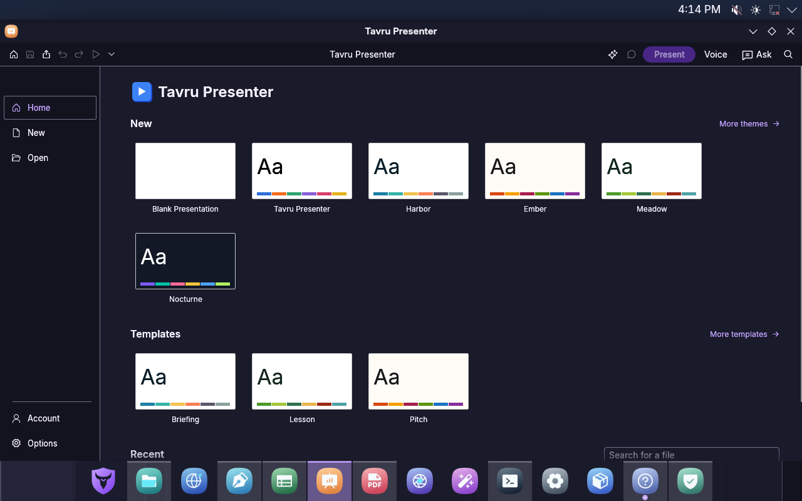

# Turn an Analytics dashboard into a presentation

[All guides](README.md) · [Build the sample dashboard](analytics.md)

Use the sample sales dashboard to make a short briefing. Start with this finding: **West led sales at 3,000, out of 8,400 total**.

1. In **Tavru Analytics**, open the dashboard and clear any temporary filter you want excluded from the report. Check the chart titles and values, then use the PowerPoint export command. Choose the dashboard as the export scope if your build offers several scopes.
2. Open the resulting PPTX in **Tavru Presenter**. Inspect each imported slide before editing. Check chart readability, legends and clipping. Exported charts may be static, so make data corrections in Analytics and export again.
3. Add a title slide and a takeaway slide. Select the chart slide and write a short note in the notes pane. For example, “West contributed about 36% of total sample sales. That number combines January and February.”
4. Play the slideshow and check it at the intended display size. Save the editable PPTX. Use PDF export for a handout and open the resulting file in Tavru PDF to check pages and text. Check whether notes appear in the output before sharing it.

The PPTX is the working deck. Use the separately checked PDF for readers who only need the handout.
