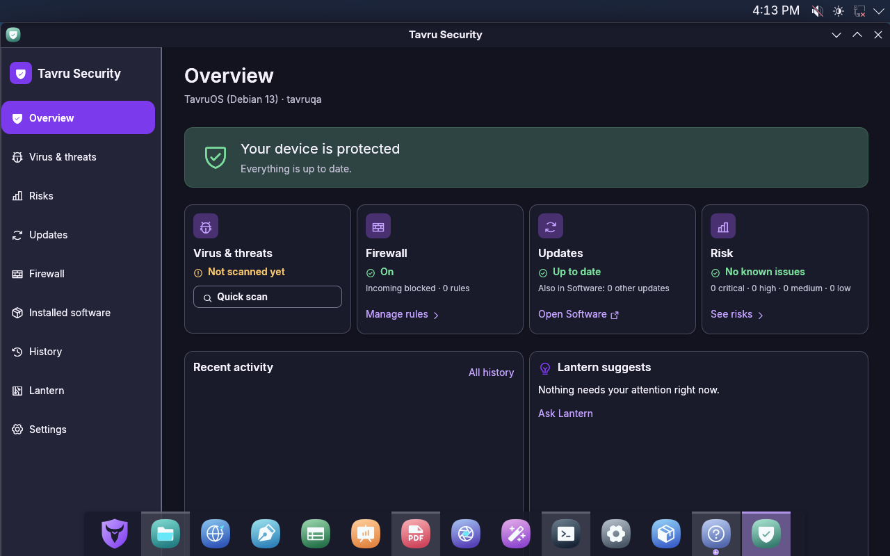

# Preview a firewall change and practice rollback

[All guides](README.md) · [Tavru Security quickstart](apps.md#tavru-security)

Practice in **Demo data** mode or in a disposable VM from its local console. This exercise uses an inbound **block** rule for an unused test port. Before touching a live firewall, confirm the app’s status and that you are on the VM you intend to change.

1. Open **Tavru Security**. Check the sidebar. **Demo data** means firewall actions use simulated state. A live session needs the installed native helper and any required authorization.
2. Open **Firewall → Add rule**. In your practice environment, choose an inbound block rule for an unused TCP port such as **18080**. Leave existing rules and the default policy in place.
3. Open the preview. Check the direction, action, protocol, port and any address or network scope. Cancel if anything differs from the intended rule.
4. Apply the reviewed change. In a live session, authorize it if prompted. When the countdown appears, choose **Undo** and verify that the new rule disappears. To practice automatic rollback, repeat the exercise and let the timer expire without choosing **Keep**.
5. Review **History** to see the outcome. **Keep** commits a pending change when its behavior has been verified. On a live system, verify from the local console that expected connections still work before keeping a real change.

This walkthrough teaches the preview and recovery flow. It does not require opening a port or disabling the firewall.
