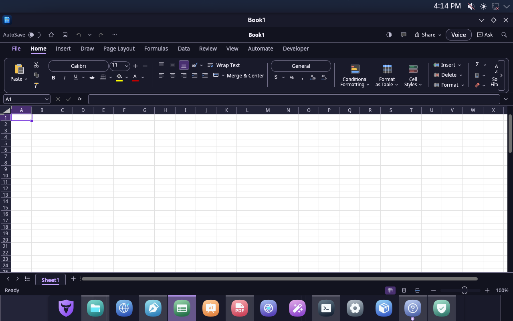

# Clean sales data in Tavru Sheets and share it with Excel

[All guides](README.md) · [Analytics dashboard guide](analytics.md)

Use [sales-cleanup.csv](samples/sales-cleanup.csv) to practice standardizing region labels. The formula uses standard spreadsheet functions supported by Tavru Sheets and Microsoft Excel. Save the result as an XLSX workbook so recipients can open it and edit the formulas.



## Create the shared workbook

1. Open the CSV in Tavru Sheets. Confirm **Region** is column A, **Product** is B, and **Revenue** is C. Check that the revenue cells are numeric.
2. Enter `Clean Region` in **D1** and `=PROPER(TRIM(A2))` in **D2**. Fill the formula down through **D7**. You should see **East, North, West, East, North, West**.
3. Save a copy as **Excel Workbook (.xlsx)**. Open the exported copy to check the formulas, cleaned labels, and numeric values before sharing. Excel users can edit the region in column A and the label in column D will recalculate.
4. If the recipient only needs the cleaned data, paste the formula results as values into a separate copy before sharing. This is also useful when importing into a tool that reads stored values without recalculating formulas.
5. In Tavru Analytics, choose **Connect**, open the XLSX, and select the worksheet. Put **Clean Region** on **Columns** and **Sum of Revenue** on **Rows**. Expect **East 2,800**, **North 2,600**, and **West 3,000**.

No Tavru add-in, Python installation, or macro is needed to open or recalculate the shared workbook.

## Optional local automation in Tavru Sheets

Use this workflow in a separate working copy if you want to replace the region labels in place. It requires Python 3 and a Tavru Sheets build with the `workbook` scripting API. The API runs inside Tavru Sheets. Excel recipients use the resulting cell values and formulas.

1. Open **Developer → Code Editor**, select **Python**, and paste the script below. Run only scripts you trust because they execute with your account’s permissions.
2. Choose **Run preview**. Verify the changes are limited to **A2:A7** on the first worksheet. Choose **Apply script changes**. You can undo the changes as a group.
3. For sharing, copy the cleaned cells into a fresh workbook and save that copy as **.xlsx**. In Analytics, use **Region** as the grouping field for this in-place workflow.

```python
rows = workbook.read("A2:A7")
cleaned = [[value.strip().title()] for (value,) in rows]
workbook.write("A2:A7", cleaned)
print(f"Normalized {len(cleaned)} region labels.")
```

The sample assumes every cell in the range contains text. Inspect the worksheet and range when adapting it to another file. Run a new preview if the workbook changes after the first one.
